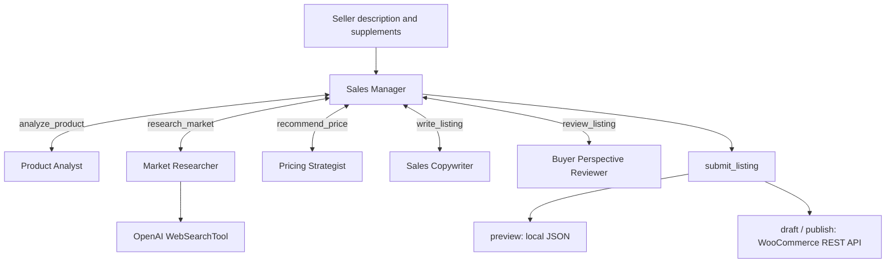
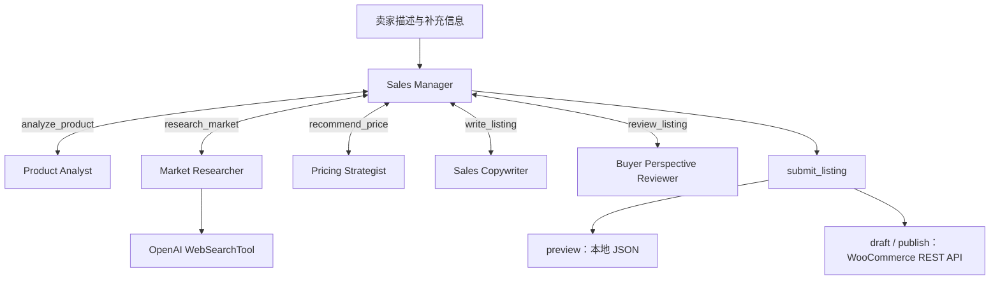

# WooCommerce Multi-Agent Product Listing Assistant

[English](#english) | [中文](#中文)

## English

### 1. Overview

This command-line application turns a seller's description into a reviewed WooCommerce product listing. One main agent coordinates five specialist subagents to analyze the product, research comparable prices, recommend a price, write listing copy, and review the result. The completed listing can become a local preview, a store draft, or a published product.

| Technology | Role |
|---|---|
| OpenAI Agents SDK | Agent definitions, agents exposed as tools, hosted web search, tool execution, conversation history, and structured results |
| OpenAI Responses API | Model responses for the main agent and all five subagents |
| Pydantic | Typed output models and validation of agent results |
| WooCommerce REST API | Creation of simple products in the configured WordPress store |

Seller descriptions and reference materials may be in Chinese or English. Agent instructions require generated explanations, follow-up questions, analyses, and listing copy to use English. Exact identifiers, model numbers, brand names, and URLs are preserved where needed; search queries may use the source market's language.

### 2. Main Agent and Tool-Based Subagents

#### Main agent: Sales Manager

[manager_agent.py](manager_agent.py) defines `build_manager_agent()`, which creates the **Sales Manager**. It receives the seller's request, keeps control of the conversation, and provides the final response.

The manager delegates work to the specialists, asks for essential missing information, coordinates revisions after review, and calls `submit_listing` when the listing is ready. Its structured output is `ManagerAnswer`, with `message` and `questions` fields. [main.py](main.py) creates shared state, assembles the team, and starts the manager with `Runner.run()`.

#### Five subagents exposed through `.as_tool()`

[agent_team.py](agent_team.py) creates each specialist and wraps it with `.as_tool()`. The manager calls the resulting tool and receives the specialist's result while retaining responsibility for the next step.

| Subagent and code file | Tool name | Responsibility | Output model / state key |
|---|---|---|---|
| **Product Analyst** — [product_agent.py](product_agent.py), `build_product_agent()` | `analyze_product` | Organize confirmed product details, condition, defects, accessories, and selling goals; identify essential missing facts. | `ProductFacts` / `facts` |
| **Market Researcher** — [market_agent.py](market_agent.py), `build_market_agent()` | `research_market` | Find comparable products from web results and seller materials; record prices, currencies, sources, condition, observation times, comparability, and limitations. | `MarketReport` / `market` |
| **Pricing Strategist** — [pricing_agent.py](pricing_agent.py), `build_pricing_agent()` | `recommend_price` | Recommend a price from product facts, market evidence, and seller goals; explain reasoning, confidence, and negotiation advice. | `PricingAdvice` / `pricing` |
| **Sales Copywriter** — [listing_agent.py](listing_agent.py), `build_listing_agent()` | `write_listing` | Write the title, short description, and full description from confirmed facts and pricing; suggest useful product photos. | `ListingCopy` / `copy` |
| **Buyer Perspective Reviewer** — [review_agent.py](review_agent.py), `build_review_agent()` | `review_listing` | Check omitted defects, unsupported claims, contradictions, and buyer confusion; return approval, required fixes, and optional suggestions. | `ReviewReport` / `review` |

For example, `build_team()` registers the product analyst as follows:

```python
product_agent.as_tool(
    tool_name="analyze_product",
    tool_description="Organize product facts and identify essential missing information.",
    custom_output_extractor=save_specialist_result("facts"),
    max_turns=4,
)
```

The output extractor saves the typed result in shared state and returns its JSON to the manager. All output models are defined in [models.py](models.py). Here, `copy` means the written product listing; `PriceReference` describes a comparable product inside `MarketReport` and is not another agent.

#### Additional tools

| Tool | Called by | Implementation | Function |
|---|---|---|---|
| `WebSearchTool` | Market Researcher, when web access is enabled | [market_agent.py](market_agent.py) | Use OpenAI's hosted web search and return cited web-grounded evidence to the researcher. |
| `submit_listing()` | Sales Manager | [agent_team.py](agent_team.py), using [woocommerce_client.py](woocommerce_client.py) | Check analysis and review, build the product payload, and generate a preview or create a store product. |

The manager has **six tools: five subagent tools and one submission function tool**. The hosted search tool belongs to the market subagent and is not another subagent.



### 3. Workflow and Supporting Features

#### Coordination and shared state

The normal progression is **product facts → market research → pricing → listing copy → review → submission**. The manager chooses the next tool from current results rather than following a fixed Python pipeline. Its instructions request one tool call at a time, and model settings disable parallel tool calls. The instructions allow at most two revision rounds. The runner limits each manager run to 24 turns; specialist runs allow four turns each, or six for market research.

`WorkflowState` in [main.py](main.py) holds inputs, currency, mode, quantity, references, stage results, tool events, cited search-source records, the payload, and the submission receipt. [agent_instructions.py](agent_instructions.py) supplies common rules and the latest shared state whenever an agent starts a turn. Store credentials are excluded from that context and the JSON export.

Replacing a specialist result clears dependent results in the order `facts` → `market` → `pricing` → `copy` → `review`. Repricing therefore clears old copy and review; rewriting clears the old review. A prior preview is cleared for regeneration, while receipts for real submission attempts are retained to prevent another creation attempt in that conversation.

#### Market research and pricing

Web research is enabled by default. The Market Researcher receives the Agents SDK's hosted `WebSearchTool` with medium search context. Search runs through the OpenAI Responses API, so it uses the same `OPENAI_API_KEY` as the agents and needs no separate search provider or scraping dependency. Source URLs used for pricing are preserved in `MarketReport.references`.

The market agent is instructed to search before writing its report, prefer comparable models and condition, distinguish asking prices from completed sales, and use prices explicitly shown in retrieved material. Missing prices remain `unknown`; access restrictions and fictional references must be explained. These evidence rules are agent instructions, not an independent verification of every quoted price.

Pricing considers condition, accessories, defects, selling speed, and market evidence. An explicitly fixed seller price should be respected. If usable evidence is unavailable, an explicit seller price may be used with an explanation. If neither is available, the agent returns `suggested_price=null`. Foreign currencies are not automatically converted.

`--no-web` omits the hosted search tool. The OpenAI model still analyzes seller information and supplied references.

#### Follow-up questions and submission checks

The application uses product facts, pricing, and review to identify essential questions. In interactive mode, supplements are added to shared state and the existing conversation history. Optional improvements, such as adding photos, belong in suggestions.

Before preparing a preview or contacting WooCommerce, `submit_listing` checks that:

1. All five specialist results exist.
2. Product facts contain no essential unanswered questions.
3. Review is approved and has no blocking issues.
4. A suggested price is present.
5. The pricing currency matches `STORE_CURRENCY`.

These checks run in Python. The quality of factual interpretation, comparisons, and review judgments depends on model output and available evidence.

#### OpenAI model configuration

[openai_model.py](openai_model.py) defines `create_model()`. It creates an `OpenAIResponsesModel` with the official `AsyncOpenAI` client. The Agents SDK sends structured outputs, function tools, and hosted web search through the Responses API.

All agents share the configured model. `OPENAI_API_KEY` is required for `run`; tracing is disabled by the application, but model and hosted-search requests still use the OpenAI API.

### 4. Code Map

| File or directory | Purpose |
|---|---|
| [main.py](main.py) | CLI entry point, `WorkflowState`, configuration, manager execution, interaction, and JSON export |
| [agent_team.py](agent_team.py) | Team assembly, `.as_tool()` wrappers, result storage and invalidation, and submission |
| [agent_instructions.py](agent_instructions.py) | Shared language and factuality rules; dynamic instructions containing current state |
| [manager_agent.py](manager_agent.py) | Main agent instructions and constructor |
| [product_agent.py](product_agent.py), [market_agent.py](market_agent.py), [pricing_agent.py](pricing_agent.py), [listing_agent.py](listing_agent.py), [review_agent.py](review_agent.py) | Instructions and constructors for the five specialist subagents |
| [models.py](models.py) | `ProductFacts`, `PriceReference`, `MarketReport`, `PricingAdvice`, `ListingCopy`, `ReviewReport`, and `ManagerAnswer` |
| [openai_model.py](openai_model.py) | OpenAI Responses model and client configuration |
| [woocommerce_client.py](woocommerce_client.py) | Store configuration, product payload construction, and creation requests |
| [.env.example](.env.example), [requirements.txt](requirements.txt) | Configuration template and Python dependencies |
| [examples/request.txt](examples/request.txt) | Used-monitor request for the fictional reference example |
| [examples/request_web.txt](examples/request_web.txt) | Online-research preview example without a seller-specified price |
| [examples/market_samples.json](examples/market_samples.json) | Fictional prices labeled for a classroom demonstration |
| [tests/](tests/) | Offline workflow, model, interaction, search, and store tests |
| `outputs/` | Generated JSON results; default file: `latest.json` |
| `local_app/` | Local WordPress desktop application files present in this workspace, separate from the Python assistant |

`.venv/` and `__pycache__/` are generated environment and bytecode directories. `.gitignore` excludes these, `.env`, `outputs/`, and `local_app/`.

Suggested reading order: `main.py` → `agent_team.py` → the six agent modules → `models.py` → `openai_model.py` and `woocommerce_client.py`.

### 5. Installation and Configuration

The project is tested with Python 3.12. Run these commands in PowerShell from the project directory:

```powershell
python -m venv .venv
.\.venv\Scripts\python.exe -m pip install -r requirements.txt
```

For first-time configuration, copy the template and fill in `.env`:

```powershell
Copy-Item .env.example .env
```

Reuse an existing configured `.env` file. The application loads it from the project directory; existing process environment variables take precedence.

| Variable | Default in code | Purpose |
|---|---|---|
| `OPENAI_API_KEY` | Empty | Required for `run`, including preview and hosted web search |
| `OPENAI_BASE_URL` | OpenAI's official API | Optional OpenAI-compatible Responses API endpoint |
| `OPENAI_MODEL` | `gpt-5-nano` | Low-cost Responses API model used by every agent |
| `WOOCOMMERCE_URL` | Empty | WordPress site root URL for `draft` and `publish` |
| `WOOCOMMERCE_CONSUMER_KEY` | Empty | Store REST API consumer key |
| `WOOCOMMERCE_CONSUMER_SECRET` | Empty | Store REST API consumer secret |
| `STORE_CURRENCY` | `CNY` | Expected pricing currency, normalized to uppercase |

`gpt-5-nano` is the official-endpoint default. When `OPENAI_BASE_URL` points to a compatible provider, set `OPENAI_MODEL` to a model name offered by that provider. The endpoint must support the Responses API and function calling; hosted web search may not be available, so test with `--no-web` first. Replace the template's placeholder store URL before submission.

Dependencies pin `openai-agents==0.15.1` and `openai==2.34.0`, and include `httpx` and `python-dotenv`. Pydantic is installed through SDK dependencies. Preview needs an OpenAI API key but no WooCommerce credentials. Structure checks and offline tests need neither service's credentials.

### 6. Usage

#### Inspect the agent structure

```powershell
.\.venv\Scripts\python.exe main.py check
```

This lists the manager and its six tools without model, search, or store requests.

#### Preview with demonstration references

```powershell
.\.venv\Scripts\python.exe main.py run --request-file examples/request.txt --references examples/market_samples.json --no-web
```

The references are fictional classroom data, not real market observations. This command uses the OpenAI model, skips hosted web research, and saves a local preview if the workflow completes.

#### Preview with online research

```powershell
.\.venv\Scripts\python.exe main.py run --request-file examples/request_web.txt
```

The terminal shows completed stages, the manager's response, and the output location. If essential information is missing, results and questions are saved. Web citations used by the researcher appear in the market references.

#### Describe a product interactively

```powershell
.\.venv\Scripts\python.exe main.py run --interactive
```

Include known specifications, condition, defects, accessories, selling goals, and transaction terms. Without `--request` or `--request-file`, the program prompts for a description and enables interactive follow-ups automatically. Press Enter at a follow-up prompt to finish without more input.

#### Create a store draft or publish

Prepare a WordPress site with WooCommerce enabled, a working REST API, and a consumer key and secret with product-write permissions. Configure its root URL and credentials in `.env`, and match `STORE_CURRENCY` to the store's actual currency. A local HTTPS site's certificate must be trusted by the Python HTTP client.

| Mode | Behavior |
|---|---|
| `preview` | Default: prepare local results without a store request |
| `draft` | Create a draft product through the store API |
| `publish` | Create and publish a product through the store API |

```powershell
.\.venv\Scripts\python.exe main.py run --interactive --mode draft
.\.venv\Scripts\python.exe main.py run --interactive --mode publish
```

The command-line mode selects the operation. After the required stages pass, `draft` and `publish` submit without a separate confirmation prompt.

The client posts to `/wp-json/wc/v3/products`. The payload creates a `simple` product with a title, descriptions, `regular_price`, and managed stock. Plain-text descriptions are escaped for HTML. Preview payloads use `status="draft"` but remain local. The application does not accept or submit product images; it may only provide text-based photo suggestions.

#### Command-line options

| Option | Purpose |
|---|---|
| `--request "Product description"` | Supply the description directly |
| `--request-file path` | Read a UTF-8 description file; mutually exclusive with `--request` |
| `--references path` | Supply UTF-8 JSON or text market reference material |
| `--no-web` | Disable web search and page reading |
| `--interactive` | Read supplements when essential questions remain |
| `--mode preview/draft/publish` | Select the output/store action; default: `preview` |
| `--quantity number` | Set stock quantity; default: `1` |
| `--output path` | Choose the result JSON; default: the project's `outputs/latest.json` |

Explicit relative paths use the current working directory. Run `main.py run --help` to inspect the options.

### 7. Saved Results and Submission Status

The application saves UTF-8 JSON after each manager response and in the runner loop's `finally` block, retaining completed work if execution is interrupted during that loop.

| JSON field | Content |
|---|---|
| `request` | Seller description and accumulated supplements |
| `mode`, `currency` | Selected mode and expected pricing currency |
| `results` | Available `facts`, `market`, `pricing`, `copy`, and `review` results |
| `answer` | Manager message and essential questions |
| `woocommerce_payload` | Prepared product data, or `null` before preparation |
| `submission_receipt` | Preview or submission record, or `null` before submission |
| `tool_events` | Completed specialist and submission events |
| `web_lookups` | OpenAI web-search provider label and the cited source records returned in the market report |

Incomplete or invalidated stages may be absent. The default output file is overwritten; use `--output` to preserve separate runs.

Receipts distinguish **`preview`** (local data only), **`draft` / `publish`** (the store returned a product status, ID, and link), and **`unknown`** (creation was attempted but no successful response was recorded). The program sets `unknown` before posting, preserving that status after a failed or interrupted attempt. Draft links may require administrator login.

### 8. Offline Tests

```powershell
.\.venv\Scripts\python.exe -m unittest discover -s tests -v
```

| Test file | Coverage |
|---|---|
| [tests/test_workflow.py](tests/test_workflow.py) | SDK orchestration, five specialist tools, independent shared states, revisions, submission checks, duplicate prevention, interrupted submission, payloads, and mocked store responses |
| [tests/test_openai.py](tests/test_openai.py) | OpenAI Responses model configuration, API-key validation, hosted web-search setup, and `--no-web` behavior |
| [tests/test_interaction.py](tests/test_interaction.py) | Essential versus optional questions, supplements and history, noninteractive output, and multilingual input/export |

Model responses and store responses are simulated. The tests verify local behavior without API credits or store changes; they do not establish live service availability or market-price accuracy.

### 9. Current Scope

The project creates simple WooCommerce products. It does not implement variations, updates to existing products, order management, shipping configuration, or automatic image generation. Seller-provided delivery terms are included in listing text.

Although the directory is named `project_openaiSDK_MCP`, the current store integration uses direct WooCommerce REST requests; no MCP client or server is implemented. `local_app/` is an external WordPress hosting application, while the Python assistant runs from the command line.

Each program start creates a new state. Saved JSON is for inspecting results, not resuming sessions, and duplicate-submission protection does not extend across separate runs. Search evidence can be incomplete or inaccessible, and model instructions do not independently verify each quoted price against its source.

---

## 中文

### 1. 项目概述

本项目是一个命令行应用，将卖家的商品描述整理为经过审核的 WooCommerce 商品信息。一个主智能体协调五个专业子智能体，依次完成商品分析、同类商品价格调研、定价建议、商品文案撰写和审核。完成后的商品信息可以生成本地预览、保存为店铺草稿，或直接发布。

| 技术 | 作用 |
|---|---|
| OpenAI Agents SDK | 定义智能体、将智能体包装为工具、使用托管网页搜索、执行工具、管理对话历史及结构化结果 |
| OpenAI Responses API | 为主智能体和全部五个子智能体提供模型响应 |
| Pydantic | 定义输出数据模型并校验智能体结果 |
| WooCommerce REST API | 在配置的 WordPress 店铺中创建简单商品 |

卖家描述和参考材料可以使用中文或英文。智能体指令要求生成的解释、追问、分析和商品文案使用英文；必要时保留准确的标识符、型号、品牌名称和 URL。搜索关键词可以使用目标市场的语言。

### 2. 主智能体与工具化子智能体

#### 主智能体：Sales Manager

[manager_agent.py](manager_agent.py) 中的 `build_manager_agent()` 创建 **Sales Manager（销售经理）**。它接收卖家需求，负责对话的整体协调，并给出最终回复。

主智能体将专业工作分配给子智能体，追问必要的缺失信息，根据审核反馈安排修改，并在商品信息准备就绪后调用 `submit_listing`。其结构化输出为 `ManagerAnswer`，包含 `message` 和 `questions` 字段。[main.py](main.py) 创建共享状态、组装团队，并通过 `Runner.run()` 启动主智能体。

#### 通过 `.as_tool()` 包装的五个子智能体

[agent_team.py](agent_team.py) 创建各个专业子智能体，并调用 `.as_tool()` 将其包装成工具。主智能体调用工具后接收子智能体的结果，再决定下一步操作。

| 子智能体及代码文件 | 工具名称 | 职责 | 输出模型 / 状态键 |
|---|---|---|---|
| **Product Analyst（商品分析员）** — [product_agent.py](product_agent.py)，`build_product_agent()` | `analyze_product` | 整理已经确认的商品信息、成色、缺陷、配件和出售目标，识别必要的缺失事实。 | `ProductFacts` / `facts` |
| **Market Researcher（市场调研员）** — [market_agent.py](market_agent.py)，`build_market_agent()` | `research_market` | 从网页结果和卖家材料中寻找可比商品，记录价格、币种、来源、成色、观察时间、可比性及局限。 | `MarketReport` / `market` |
| **Pricing Strategist（定价策略师）** — [pricing_agent.py](pricing_agent.py)，`build_pricing_agent()` | `recommend_price` | 根据商品事实、市场证据和卖家目标建议价格，说明定价理由、置信程度和议价建议。 | `PricingAdvice` / `pricing` |
| **Sales Copywriter（销售文案员）** — [listing_agent.py](listing_agent.py)，`build_listing_agent()` | `write_listing` | 根据已确认的事实和定价撰写标题、简短描述及完整描述，并提出商品照片建议。 | `ListingCopy` / `copy` |
| **Buyer Perspective Reviewer（买家视角审核员）** — [review_agent.py](review_agent.py)，`build_review_agent()` | `review_listing` | 检查遗漏的缺陷、缺乏依据的表述、内容矛盾及可能引起买家困惑的问题，给出审核结论、必要修改和可选建议。 | `ReviewReport` / `review` |

例如，`build_team()` 使用以下方式注册商品分析员：

```python
product_agent.as_tool(
    tool_name="analyze_product",
    tool_description="Organize product facts and identify essential missing information.",
    custom_output_extractor=save_specialist_result("facts"),
    max_turns=4,
)
```

输出提取器将带类型的结果保存到共享状态，并以 JSON 返回给主智能体。全部输出模型定义在 [models.py](models.py) 中。这里的 `copy` 指商品文案；`PriceReference` 用于描述 `MarketReport` 中的可比商品，并不是另一个智能体。

#### 其他工具

| 工具 | 调用者 | 实现位置 | 功能 |
|---|---|---|---|
| `WebSearchTool` | 开启联网功能时的 Market Researcher | [market_agent.py](market_agent.py) | 使用 OpenAI 托管网页搜索，并向调研智能体返回带引用的联网证据。 |
| `submit_listing()` | Sales Manager | [agent_team.py](agent_team.py)，调用 [woocommerce_client.py](woocommerce_client.py) | 检查分析与审核结果，构建商品请求数据，生成预览或在店铺中创建商品。 |

主智能体共有**六个工具：五个子智能体工具和一个提交函数工具**。托管搜索工具属于市场调研子智能体，并不是另一个子智能体。



### 3. 工作流程与配套功能

#### 协调与共享状态

通常的流程为**商品事实 → 市场调研 → 定价 → 商品文案 → 审核 → 提交**。主智能体根据当前结果选择下一项工具，流程并非由固定的 Python 调用顺序决定。指令要求每次只调用一个工具，模型设置也关闭了并行工具调用。指令最多允许两轮修改。运行器将主智能体的每次运行限制为 24 轮；各子智能体最多运行 4 轮，市场调研子智能体为 6 轮。

[main.py](main.py) 中的 `WorkflowState` 保存输入、币种、模式、数量、图片、参考材料、各阶段结果、工具事件、带引用的搜索来源记录、商品请求数据和提交回执。[agent_instructions.py](agent_instructions.py) 在智能体开始每一轮时提供通用规则和最新共享状态。店铺凭据不会进入这些上下文或导出的 JSON。

重新生成某个阶段的结果，会按照 `facts` → `market` → `pricing` → `copy` → `review` 的依赖顺序清除后续结果。因此，重新定价会清除旧文案和旧审核结果；重写文案会清除旧审核结果。已有预览会被清除，以便重新生成；实际提交尝试的回执则会保留，避免在同一段对话中再次创建商品。

#### 市场调研与定价

默认开启联网调研。Market Researcher 使用 Agents SDK 的托管 `WebSearchTool`，搜索上下文设为 `medium`。搜索通过 OpenAI Responses API 完成，因此与智能体共用 `OPENAI_API_KEY`，不再需要单独的搜索服务或网页抓取依赖。用于定价的来源 URL 保存在 `MarketReport.references` 中。

市场调研智能体的指令要求先搜索再撰写报告，优先选择型号和成色可比的商品，区分挂牌价与已成交价格，并仅使用检索材料中明确显示的价格。缺失价格记为 `unknown`；访问限制和虚构参考材料必须说明。这些证据规则属于智能体指令，并不构成对每一项引用价格的独立核验。

定价综合考虑成色、配件、缺陷、出售速度和市场证据。卖家明确指定不可更改的价格时，应尊重该价格。没有可用市场证据时，可以采用卖家明确提供的价格，并说明局限；两者都不存在时，返回 `suggested_price=null`。程序不会自动换算外币。

`--no-web` 不向市场调研智能体提供托管搜索工具，但 OpenAI 模型仍会分析卖家信息和提供的参考材料。

#### 补充提问与提交检查

程序根据商品事实、定价和审核结果识别必要问题。交互模式下，卖家的补充内容会加入共享状态和已有对话历史。补充照片等可选改进应作为建议提出。

生成预览或联系 WooCommerce 之前，`submit_listing` 会检查：

1. 五个专业子智能体的结果均已生成。
2. 商品事实中没有尚未回答的必要问题。
3. 审核已通过，且不存在阻碍提交的问题。
4. 已提供建议价格。
5. 定价币种与 `STORE_CURRENCY` 一致。

这些检查由 Python 代码执行。事实理解、商品比较和审核判断的质量仍取决于模型输出及可用证据。

#### OpenAI 模型配置

[openai_model.py](openai_model.py) 定义 `create_model()`，使用官方 `AsyncOpenAI` 客户端创建 `OpenAIResponsesModel`。Agents SDK 通过 Responses API 处理结构化输出、函数工具和托管网页搜索。

所有智能体共用配置的模型。`run` 命令需要 `OPENAI_API_KEY`；应用关闭了 tracing，但模型与托管搜索请求仍会使用 OpenAI API。

### 4. 代码与目录说明

| 文件或目录 | 用途 |
|---|---|
| [main.py](main.py) | 命令行入口、`WorkflowState`、配置读取、主智能体运行、交互与 JSON 导出 |
| [agent_team.py](agent_team.py) | 团队组装、`.as_tool()` 包装、结果保存与失效处理和提交 |
| [agent_instructions.py](agent_instructions.py) | 通用语言与事实规则，以及包含当前状态的动态指令 |
| [manager_agent.py](manager_agent.py) | 主智能体的指令与构造函数 |
| [product_agent.py](product_agent.py)、[market_agent.py](market_agent.py)、[pricing_agent.py](pricing_agent.py)、[listing_agent.py](listing_agent.py)、[review_agent.py](review_agent.py) | 五个专业子智能体的指令与构造函数 |
| [models.py](models.py) | `ProductFacts`、`PriceReference`、`MarketReport`、`PricingAdvice`、`ListingCopy`、`ReviewReport` 和 `ManagerAnswer` |
| [openai_model.py](openai_model.py) | OpenAI Responses 模型与客户端配置 |
| [woocommerce_client.py](woocommerce_client.py) | 店铺配置、商品请求数据构建及创建请求 |
| [.env.example](.env.example)、[requirements.txt](requirements.txt) | 配置模板与 Python 依赖 |
| [examples/request.txt](examples/request.txt) | 与虚构参考数据配套的二手显示器需求示例 |
| [examples/request_web.txt](examples/request_web.txt) | 卖家未指定价格、使用在线调研的预览示例 |
| [examples/market_samples.json](examples/market_samples.json) | 明确标注为课堂演示用途的虚构价格数据 |
| [tests/](tests/) | 工作流、模型、交互、搜索和店铺接口的离线测试 |
| `outputs/` | 生成的 JSON 结果；默认文件为 `latest.json` |
| `local_app/` | 当前工作区中的本地 WordPress 桌面应用文件，与 Python 助手相互独立 |

`.venv/` 和 `__pycache__/` 分别是生成的虚拟环境目录和字节码目录。`.gitignore` 排除这些目录，以及 `.env`、`outputs/` 和 `local_app/`。

建议阅读顺序：`main.py` → `agent_team.py` → 六个智能体模块 → `models.py` → `openai_model.py` 和 `woocommerce_client.py`。

### 5. 安装与配置

项目使用 Python 3.12 进行测试。在项目目录下，通过 PowerShell 执行：

```powershell
python -m venv .venv
.\.venv\Scripts\python.exe -m pip install -r requirements.txt
```

首次配置时，复制模板并填写 `.env`：

```powershell
Copy-Item .env.example .env
```

如果已有配置好的 `.env`，继续使用该文件。应用从项目目录加载配置；进程中已经存在的环境变量优先。

| 变量 | 代码中的默认值 | 用途 |
|---|---|---|
| `OPENAI_API_KEY` | 空 | `run` 命令必需，包括预览模式和托管网页搜索 |
| `OPENAI_BASE_URL` | OpenAI 官方 API | 可选的 OpenAI 兼容 Responses API 地址 |
| `OPENAI_MODEL` | `gpt-5-nano` | 所有智能体使用的低成本 Responses API 模型 |

`gpt-5-nano` 是官方接口的默认模型。使用 `OPENAI_BASE_URL` 指向兼容服务时，请将 `OPENAI_MODEL` 改为该服务提供的模型名称。该接口必须支持 Responses API 和函数调用；托管网页搜索可能不可用，因此第一次应先使用 `--no-web` 测试。
| `WOOCOMMERCE_URL` | 空 | `draft` 和 `publish` 使用的 WordPress 站点根地址 |
| `WOOCOMMERCE_CONSUMER_KEY` | 空 | 店铺 REST API consumer key |
| `WOOCOMMERCE_CONSUMER_SECRET` | 空 | 店铺 REST API consumer secret |
| `STORE_CURRENCY` | `CNY` | 预期的定价币种，读取后转为大写 |


依赖固定为 `openai-agents==0.15.1` 和 `openai==2.34.0`，并包含 `httpx` 和 `python-dotenv`。Pydantic 由 SDK 的依赖安装。预览需要 OpenAI API key，但不需要 WooCommerce 凭据；结构检查和离线测试均不需要这两项服务的凭据。

### 6. 使用方法

#### 检查智能体结构

```powershell
.\.venv\Scripts\python.exe main.py check
```

该命令列出主智能体及其六个工具，不会请求模型、搜索服务或店铺接口。

#### 使用演示参考材料生成预览

```powershell
.\.venv\Scripts\python.exe main.py run --request-file examples/request.txt --references examples/market_samples.json --no-web
```

这些参考材料是虚构的课堂数据，不是真实市场观察。该命令调用 OpenAI 模型、跳过托管网页调研，并在工作流完成时保存本地预览。

#### 使用在线调研生成预览

```powershell
.\.venv\Scripts\python.exe main.py run --request-file examples/request_web.txt
```

终端显示已完成阶段、主智能体回复和输出位置。如果缺少必要信息，程序会保存已有结果和待回答问题；调研智能体使用的网页引用会出现在市场参考数据中。

#### 通过交互描述商品

```powershell
.\.venv\Scripts\python.exe main.py run --interactive
```

描述中可包含已知规格、成色、缺陷、配件、出售目标和交易条件。未提供 `--request` 或 `--request-file` 时，程序会提示输入描述，并自动开启交互追问。在补充信息提示处直接按 Enter，可结束输入。

#### 创建店铺草稿或发布商品

准备一个已启用 WooCommerce 的 WordPress 站点，确认 REST API 可用，并创建具备商品写入权限的 consumer key 和 secret。在 `.env` 中配置站点根地址和凭据，使 `STORE_CURRENCY` 与店铺实际币种一致。使用本地 HTTPS 站点时，其证书需要被 Python HTTP 客户端信任。

| 模式 | 行为 |
|---|---|
| `preview` | 默认模式：准备本地结果，不请求店铺接口 |
| `draft` | 通过店铺 API 创建商品草稿 |
| `publish` | 通过店铺 API 创建并发布商品 |

```powershell
.\.venv\Scripts\python.exe main.py run --interactive --mode draft
.\.venv\Scripts\python.exe main.py run --interactive --mode publish
```

命令行模式决定实际操作。必要阶段通过后，`draft` 和 `publish` 会直接提交，不再出现单独的确认提示。

客户端向 `/wp-json/wc/v3/products` 发送 POST 请求。请求数据用于创建 `simple` 商品，包含标题、描述、`regular_price` 和库存管理信息。纯文本描述会进行 HTML 转义。预览请求数据使用 `status="draft"`，但只保存在本地。应用不接收或提交商品图片，只可能提供文字形式的拍摄建议。

#### 命令行参数

| 参数 | 用途 |
|---|---|
| `--request "Product description"` | 直接提供商品描述 |
| `--request-file path` | 读取 UTF-8 商品描述文件；与 `--request` 互斥 |
| `--references path` | 提供 UTF-8 JSON 或文本格式的市场参考材料 |
| `--no-web` | 关闭网页搜索和页面读取 |
| `--interactive` | 存在必要问题时接收补充信息 |
| `--mode preview/draft/publish` | 选择输出或店铺操作；默认为 `preview` |
| `--quantity number` | 设置库存数量；默认为 `1` |
| `--output path` | 指定结果 JSON 路径；默认为项目中的 `outputs/latest.json` |

显式提供的相对路径以当前工作目录为基准。执行 `main.py run --help` 可查看参数说明。

### 7. 结果保存与提交状态

程序在主智能体每次回复后，以及运行循环的 `finally` 块中保存 UTF-8 JSON。因此，在该循环执行期间中断时，已完成的工作仍会保留。

| JSON 字段 | 内容 |
|---|---|
| `request` | 卖家描述与累计补充信息 |
| `mode`、`currency` | 选择的模式与预期定价币种 |
| `results` | 已生成的 `facts`、`market`、`pricing`、`copy` 和 `review` 结果 |
| `answer` | 主智能体回复与必要问题 |
| `woocommerce_payload` | 已准备的商品请求数据；准备前为 `null` |
| `submission_receipt` | 预览或提交记录；提交前为 `null` |
| `tool_events` | 专业子智能体完成事件和提交事件 |
| `web_lookups` | OpenAI 网页搜索标识，以及市场报告中返回的引用来源记录 |

尚未完成或已经失效的阶段可能不会出现在结果中。默认输出文件会被覆盖；需要保留不同运行的结果时，使用 `--output` 指定文件。

回执区分 **`preview`**（仅本地数据）、**`draft` / `publish`**（店铺返回商品状态、ID 和链接）以及 **`unknown`**（已尝试创建，但未记录到成功响应）。程序在发送请求前将状态设为 `unknown`，请求失败或中断后会保留该状态。草稿链接可能需要管理员登录后才能访问。


### 8. 离线测试

```powershell
.\.venv\Scripts\python.exe -m unittest discover -s tests -v
```

| 测试文件 | 覆盖范围 |
|---|---|
| [tests/test_workflow.py](tests/test_workflow.py) | SDK 协调、五个子智能体工具、独立共享状态、修改流程、提交检查、防止重复创建、中断提交、商品请求数据及模拟店铺响应 |
| [tests/test_openai.py](tests/test_openai.py) | OpenAI Responses 模型配置、API key 校验、托管网页搜索配置和 `--no-web` 行为 |
| [tests/test_interaction.py](tests/test_interaction.py) | 必要问题与可选建议的区分、补充信息与历史、非交互输出，以及多语言输入和导出 |

测试中的模型响应和店铺响应均为模拟数据。测试能够在不消耗 API 额度、不修改店铺的情况下验证本地行为，但不能证明在线服务的可用性或市场价格的准确性。

### 9. 当前范围

项目用于创建 WooCommerce 简单商品，未实现可变商品、已有商品更新、订单管理、配送配置或自动生成图片。卖家提供的交付条件会写入商品文案。

虽然目录名称为 `project_openaiSDK_MCP`，当前店铺集成直接使用 WooCommerce REST 请求，没有实现 MCP 客户端或服务器。`local_app/` 是外部 WordPress 托管应用，Python 助手则通过命令行运行。

程序每次启动都会创建新的状态。保存的 JSON 用于查看结果，不能恢复会话；防止重复提交的机制也不会跨独立运行生效。搜索证据可能不完整或无法访问，智能体指令不会独立核验每一项引用价格与来源是否一致。
